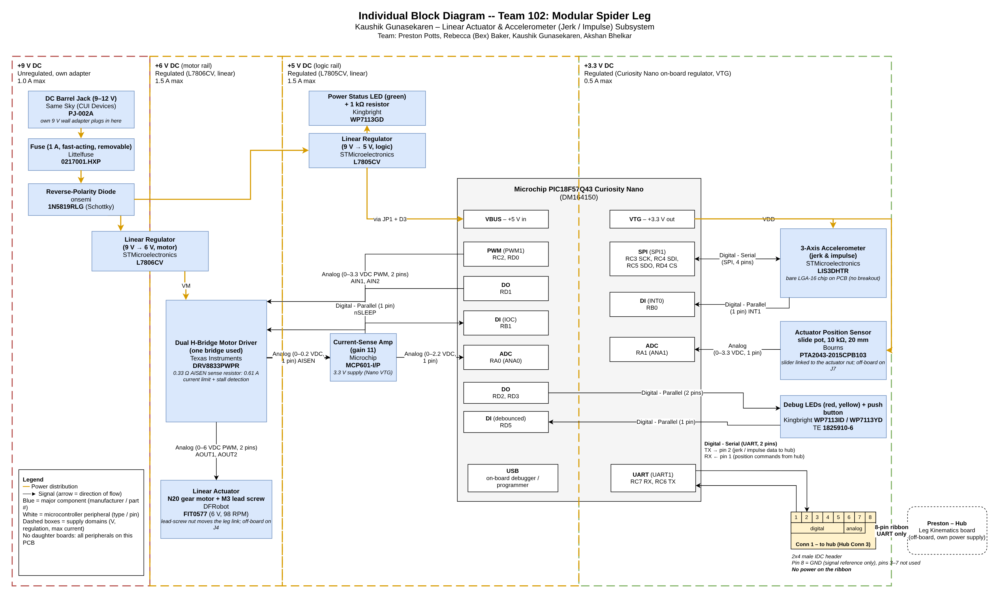

## Overview

This page shows the electrical architecture of my subsystem for Team 102's Modular Spider Leg. In the team's hub-and-spoke layout, my board is the spoke on **hub connector 3**. It drives the leg's small **linear actuator** (the actuator) and measures leg motion with an **accelerometer** for jerk and impulse sensing (the sensor). Commands come from Preston's hub board over the ribbon cable.

The design follows the [RAS 304 project requirements](https://ras-embedded-systems.pages.dev/304/course-info/project-description/):

* PIC18F57Q43 Curiosity Nano as the microcontroller.
* A 9 V barrel jack feeding a 5 V **linear** regulator, with a fuse and a power-status LED. (My board adds a second linear regulator, 6 V, for the motor only.)
* A 2x4 male IDC header using the class ribbon pinout.
* No daughter boards: every peripheral, including the accelerometer, is placed directly on this PCB.

Parts were also chosen to stay within the team's $70&ndash;80 total budget.

The block diagram shows:

* **Power levels:** my own 9 V adapter &rarr; barrel jack &rarr; 1 A fuse &rarr; 1N5819 reverse-polarity diode &rarr; two linear regulators. The **L7806CV (6 V)** feeds only the motor driver and the 6 V actuator motor. The **L7805CV (5 V)** feeds the Curiosity Nano and the power LED. The Curiosity Nano's on-board regulator supplies 3.3 V to the accelerometer, the position potentiometer and the current-sense op-amp.
* **Actuator:** a DFRobot FIT0577 N20 gear motor with an M3 lead screw, driven by a TI DRV8833 H-bridge. A 0.33 &Omega; current-sense resistor sets a 0.61 A current limit, and an MCP601 amplifier (gain 11) scales its voltage for the ADC so the PIC can detect a stall.
* **Position feedback:** a Bourns slide potentiometer whose slider moves with the actuator's lead-screw nut.
* **Sensor:** an ST LIS3DH 3-axis accelerometer chip on SPI, with a data-ready interrupt.
* **Debug:** two debug LEDs and a debounced push button on spare GPIO.
* **Team connection:** an 8-pin ribbon cable to Preston's hub board. It carries position commands in and jerk/impulse data out over UART.

## Block Diagram

  
**Figure 1:** Individual block diagram for the linear actuator and accelerometer subsystem.

Source files: [draw.io source (ZIP)](individual-block-diagram-source.zip) · [draw.io source file](individual-block-diagram.drawio)

## How the Block Diagram Was Structured

The diagram is organized left to right by **supply domain** (9 V &rarr; 6 V &rarr; 5 V &rarr; 3.3 V), so a reader can follow power from the wall adapter to every load, and each dashed box states its voltage, regulator and maximum current. The microcontroller sits in the middle with each peripheral (PWM, ADC, SPI, UART, digital I/O) drawn as its own white block, so every signal line shows its type, pin count and the PIC pin it uses. Actuator parts are grouped on the left and sensing parts on the right, and the ribbon connector to Preston's hub is at the bottom right, matching the team block diagram.

Since the first version, two changes came from the power budget and feedback: the motor moved from the 5 V rail to its own **6 V regulator** (the 6 V motor was running under-voltage and the 5 V regulator was overheating), and an **op-amp** was added after the current-sense resistor because 0&ndash;0.2 V used only a small slice of the ADC range.

## How the Design Meets the Product Requirements

| Requirement (team) | How this board meets it |
|---|---|
| **2.2** Standard communication protocols | UART to the hub over the ribbon; SPI to the accelerometer |
| **2.3** Modular software: motion, sensing, communication separated | Separate peripherals for motion (PWM + position ADC), sensing (SPI + interrupt) and communication (UART) |
| **4.4 / 5.2** Off-the-shelf parts and connectors | Catalog parts only; motor and slide pot plug into headers so they can be replaced |
| **6.1** Current limiting or stall detection on actuators | DRV8833 0.61 A current limit, amplified current sense on RA0, and nFAULT on RB1 |
| **6.3** Over-voltage and over-current protection | 1 A fuse, reverse-polarity diode, regulators with internal current limit and thermal shutdown |
| **6.4** Fail-safe stop if communication is lost | nSLEEP (RD1) has a pull-down, so the motor driver stays off while the PIC is in reset; firmware can also pull nSLEEP low to stop the motor if hub commands stop arriving |

## Major Components and Cost

| Function | Manufacturer | Part Number | Supply | Approx. Cost |
|---|---|---|---|---|
| Microcontroller | Microchip | PIC18F57Q43 Curiosity Nano (DM164150) | 5 V (VBUS) | Course kit |
| Linear actuator | DFRobot | FIT0577 N20 gear motor, 6 V, 98 RPM, with M3 &times; 20 mm lead-screw shaft | 6 V | $9.00 |
| Motor driver (H-bridge) | Texas Instruments | DRV8833PWPR | 6 V (VM) | $3.02 |
| Position sensor | Bourns | PTA2043-2015CPB103 (10 k&Omega; slide pot, 20 mm travel) | 3.3 V | $1.84 |
| Accelerometer (bare chip) | STMicroelectronics | LIS3DHTR | 3.3 V | $1.94 |
| Current-sense amplifier | Microchip | MCP601-I/P | 3.3 V | ~$0.50 |
| Linear regulator (9 V &rarr; 6 V, motor) | STMicroelectronics | L7806CV | 9 V in | ~$0.65 |
| Linear regulator (9 V &rarr; 5 V, logic) | STMicroelectronics | L7805CV | 9 V in | $0.65 |
| Reverse-polarity diode | onsemi | 1N5819RLG | 9 V | ~$0.10 |
| Fuse (1 A, fast-acting, removable) | Littelfuse | 0217001.HXP + 2&times; Keystone 3517 clips | 9 V | ~$1 |
| Barrel jack | CUI Devices | PJ-002A | 9 V | ~$1 |
| Power status LED (green) + 1 k&Omega; resistor | Kingbright | WP7113GD | 5 V | ~$0.30 |
| 2x4 IDC header, sense resistor, capacitors | &mdash; | &mdash; | &mdash; | ~$1.50 |
| 9 V wall adapter | &mdash; | &mdash; | &mdash; | Already owned |
| **Total (new purchases, before shipping)** | | | | **~$21.50** |

The team budget is $70&ndash;80 for four boards, so an even share is $17.50&ndash;$20.00. Adding the 6 V regulator, op-amp and diode puts this board slightly above that range, so the team total should be checked. The fuse, jack, LED and passive costs are estimates. A plain 300 RPM N20 motor ($6.95) with a separate threaded rod and coupler would save about $2 but needs extra mechanical work. See the [Component Selection](../02-Component-Selection/Component-Selection.md) page.

## Power Domains

| Domain | Regulation | Max Current | Source | Loads |
|---|---|---|---|---|
| +9 V DC | Unregulated | 1.0 A | My 9 V wall adapter, through the barrel jack, a 1 A fuse and a 1N5819 diode | L7806CV and L7805CV inputs |
| +6 V DC | Regulated (linear) | 1.5 A | ST L7806CV | DRV8833 (VM) and the N20 motor |
| +5 V DC | Regulated (linear) | 1.5 A | ST L7805CV | Curiosity Nano (VBUS, through JP1 and D3), power LED |
| +3.3 V DC | Regulated | 0.5 A | Curiosity Nano on-board regulator (VTG pin) | LIS3DHTR, slide potentiometer, MCP601 |

With the motor on its own regulator, the L7805CV carries only about 0.13 A and needs no heatsink. See the [Power Budget](../05-Power-Budget/Power-Budget.md) page for the current and heat calculations.

## Microcontroller Peripherals and Pins

| Peripheral | PIC18F57Q43 Pin(s) | Connected To | Signal (Type, Pins) |
|---|---|---|---|
| PWM (PWM1) | RC2, RD0 | DRV8833 AIN1, AIN2 | Analog (0&ndash;3.3 VDC PWM, 2 pins) |
| DO | RD1 | DRV8833 nSLEEP | Digital - Parallel (1 pin) |
| DI (interrupt-on-change) | RB1 | DRV8833 nFAULT | Digital - Parallel (1 pin) |
| ADC | RA0 (ANA0) | MCP601 output (amplified AISEN sense voltage) | Analog (0&ndash;2.2 VDC, 1 pin) |
| ADC | RA1 (ANA1) | Slide potentiometer wiper | Analog (0&ndash;3.3 VDC, 1 pin) |
| SPI (SPI1) | RC3 SCK, RC4 SDI, RC5 SDO, RD4 CS | LIS3DHTR | Digital - Serial (SPI, 4 pins) |
| DI (INT0) | RB0 | LIS3DHTR INT1 (data ready) | Digital - Parallel (1 pin) |
| UART (UART1) | RC7 RX, RC6 TX | Ribbon connector pins 1 and 2 | Digital - Serial (UART, 2 pins) |
| DO | RD2, RD3 | Debug LEDs | Digital - Parallel (2 pins) |
| DI | RD5 | Debug push button (debounced) | Digital - Parallel (1 pin) |
| USB | On-board debugger | PC (programming / debugging) | USB |

The DRV8833 drives the motor through AOUT1 and AOUT2: Analog (0&ndash;6 VDC PWM, 2 pins).

## Team Connection

My board connects to Preston's hub board (Leg Kinematics) through **hub connector 3**, using the class-standard 8-pin ribbon cable and a 2x4 male IDC header. The ribbon carries signals and a shared ground only; my board is powered by its own 9 V adapter.

| Pin | Type | Signal | Direction | MCU Pin |
|:---:|---|---|---|---|
| 1 | Digital | UART RX: position commands from the hub | Hub &rarr; my board | RC7 (U1RX) |
| 2 | Digital | UART TX: jerk / impulse data to the hub | My board &rarr; hub | RC6 (U1TX) |
| 3&ndash;5 | Digital | Not used | &mdash; | &mdash; |
| 6&ndash;7 | Analog | Not used | &mdash; | &mdash; |
| 8 | GND | Common ground | &mdash; | GND |

## Design Notes

* **Closed-loop position control:** the hub sends a target position over UART. The PIC compares it with the slide-pot reading on RA1, then drives the two PWM outputs (RC2, RD0) to move the lead screw forward or back.
* **Stall and fault protection (Req. 6.1):** current through the DRV8833 flows through a 0.33 &Omega; sense resistor on AISEN. An MCP601 amplifies that voltage by 11, and the PIC reads it on RA0 and stops the motor if the current stays high, which indicates a stall. The same resistor also sets the driver's built-in current limit at about 0.61 A (0.2 V &divide; 0.33 &Omega;), which keeps a motor fault within what my 1 A adapter can supply. The nFAULT pin (RB1) reports over-current or over-temperature, and the PIC then disables the driver through nSLEEP (RD1).
* **Jerk and impulse sensing:** the LIS3DH data-ready interrupt (RB0) triggers an SPI read of acceleration at up to about 1.3 kHz. Jerk is found by differentiating acceleration, and impulse by integrating force (mass &times; acceleration) over the foot-contact time. The results are sent to the hub over UART.
* **Accelerometer soldering:** the LIS3DHTR is a 3 &times; 3 mm LGA-16 package. Because daughter boards aren't allowed, it is soldered directly to the PCB with a stencil and hot air or reflow.
* **Speed vs. cost:** a standard M3 lead screw moves 0.5 mm per turn, so the 98 RPM (60 RPM under load) FIT0577 gives about 0.5&ndash;0.8 mm/s. That is slow, but adequate for a small demonstration leg, and much cheaper than a commercial linear actuator with built-in feedback (about $80 or more).
