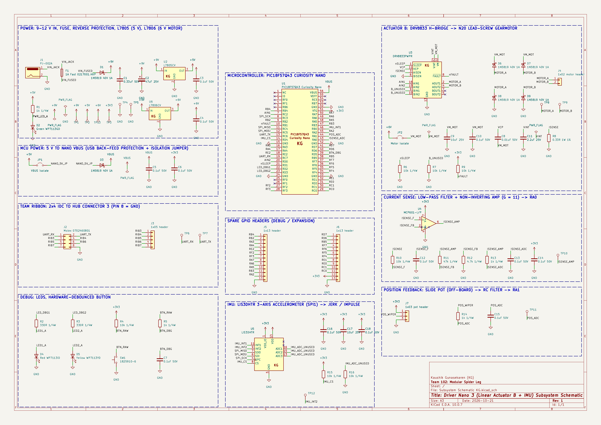

# Schematics

**RAS 304 – Individual Datasheet (Kaushik) – Driver Nano 3: Linear Actuator B + IMU**
Project: Team 102 Modular Spider Leg (my board is the spoke on hub connector 3)

**Page link:** [https://kaushikgunasekaren.github.io/kgunase7_RAS304_F26/04-Schematic/schematic/](https://kaushikgunasekaren.github.io/kgunase7_RAS304_F26/04-Schematic/schematic/)

## Overview

This schematic is my individual subsystem board, drawn in KiCad 10. It follows my [Block Diagram](../01-Block-Diagram/Block-Diagram.md), [Component Selection](../02-Component-Selection/Component-Selection.md) and [Power Budget](../05-Power-Budget/Power-Budget.md) pages. The board takes a position command from Preston's hub board over the ribbon cable. It drives Linear Actuator B (an N20 lead-screw gearmotor) through a DRV8833 H-bridge, closes the loop with a slide potentiometer, and reads an LIS3DH accelerometer for jerk / impulse sensing. Status and IMU data go back to the hub over UART.

* **Power:** a 9–12 V barrel jack feeds a removable 1 A fuse and a 1N5819 reverse-polarity diode. Two through-hole linear regulators share the C1/C2 input capacitors. The **L7805CV (5 V logic rail)** powers the Curiosity Nano and the green power LED. The **L7806CV (6 V motor rail)** powers only the DRV8833 and the N20 motor, which is rated 6 V. The Nano's on-board regulator (VTG) supplies 3.3 V to the IMU, the op-amp and the potentiometer. Only the motor and its driver run above 5 V; the raw 9–12 V reaches only the two regulator inputs.
* **Controller:** the PIC18F57Q43 Curiosity Nano, drawn as a custom symbol with my initials (KG). It is fed from 5 V through jumper JP1 and Schottky diode D3, so the Nano's USB 5 V cannot back-feed the board's 5 V rail. There are 0.1 µF bypass capacitors on VBUS and VTG.
* **Actuator with driver circuit:** a DRV8833, powered from the 6 V rail through JP2, drives the motor from AIN1/AIN2 (RC2, RD0 PWM), with nSLEEP (RD1) and nFAULT (RB1). The 0.33 Ω sense resistor sets the chopping current limit at about 0.61 A, which stays within the 1 A adapter even in a fault. D6–D9 clamp the motor's back-EMF to VM and GND. JP2 isolates the 6 V motor rail for debugging.
* **Current-sense signal conditioning:** a 159 Hz RC low-pass and an MCP601 non-inverting amplifier with a gain of 11 turn the 0–0.2 V sense voltage into 0–2.2 V for the ADC (RA0). A 1.6 kHz anti-alias filter follows the amplifier.
* **Sensor:** an LIS3DHTR on SPI1 (RC3 SCK, RC4 SDI, RC5 SDO, RD4 CS), with INT1 data-ready on RB0. The slide potentiometer (off-board, on J7) is filtered and read on RA1.
* **Team interface:** a 2x4 IDC header with pin 1 = UART RX (RC7) from the hub, pin 2 = UART TX (RC6) to the hub, and pin 8 = GND. Pins 3–7 are broken out on J3.
* **Debug and expansion:** two debug LEDs (RD2, RD3), a hardware-debounced push button (RD5), 13 bare PCB test pads, and two 13-pin spare GPIO headers that bring out every unused Nano I/O pin.

**Figure 1:** Driver Nano 3 subsystem schematic (click to enlarge, or open the PDF below for full resolution).

## Resources

* The schematic as a high-resolution PDF is available [*here*](Subsystem-Schematic-KG.pdf).
* A ZIP of the complete KiCad project, including my custom symbol library `RAS304_KG.kicad_sym`, the ERC report and the BOM export, is available [*here*](Subsystem-Schematic-KG.zip).

## How the Schematic Meets User Needs and Product Requirements

The team's users are robotics hobbyists and students who want a leg they can wire into their own robot, repair and modify (see the team's [Product Requirements](https://ras304-fall26-102.github.io/04-Product-Requirements/)). This board has to move one joint on command and report how the leg is moving, safely and with parts a user can replace. The circuit does that as follows:

* **Moving the joint on command (user need: a leg that "just works" from simple commands).** The hub sends a target position over UART (pin 1 of the ribbon, RC7). The PIC compares it with the slide-pot reading on RA1 and drives the DRV8833 with two PWM signals (RC2, RD0). Because the slide pot gives an absolute position, the joint knows where it is at power-up without a homing move.
* **Motor at its rated voltage.** The L7806CV gives the 6 V motor its full rated voltage, while the L7805CV keeps the Curiosity Nano on a separate, quieter 5 V rail. Motor start-up and stall current cannot pull the microcontroller's supply down and reset it.
* **Stall and fault protection (Req. 6.1).** The 0.33 Ω sense resistor makes the DRV8833 chop the current at about 0.61 A. The MCP601 amplifies the 0–0.2 V sense voltage to 0–2.2 V so the PIC can see a stall clearly on RA0 and stop the motor before it overheats. nFAULT (RB1) reports driver over-current or over-temperature, and D6–D9 clamp back-EMF from the motor.
* **Supply protection (Req. 6.3).** A removable 1 A fuse protects against shorts, the 1N5819 protects against a reversed adapter, and both regulators have internal current limits and thermal shutdown.
* **Safe state when the controller is not running (Req. 6.4).** nSLEEP has a 10k pull-down, so the motor driver is off while the PIC is in reset or being programmed. The LIS3DH chip select has a pull-up so the sensor stays idle. Firmware can drop nSLEEP if hub commands stop arriving.
* **Motion sensing for the team (jerk / impulse).** The LIS3DH is on SPI1 with its data-ready interrupt on RB0, so the PIC reads each new sample as soon as it is ready and computes jerk and impulse to send back to the hub over UART (RC6).
* **Standard interfaces (Req. 2.2).** UART to the hub and SPI to the sensor, over the class-standard 2x4 ribbon header.
* **Repairable and modifiable (Req. 4.3, 4.4, 5.2).** The motor (J4) and slide pot (J7) plug into headers, the fuse sits in clips, nearly every part is through-hole, and every unused Nano pin is broken out on J5 and J6. JP1 and JP2 let a user isolate the Nano or the motor rail while debugging, and the test pads, debug LEDs and button make bring-up easier.

## Custom symbols

All custom symbols are in `RAS304_KG.kicad_sym` and carry my initials (KG) in the symbol name and body:

| Symbol | Part | Notes |
|---|---|---|
| `PIC18F57Q43_Curiosity_Nano_KG` | Microchip DM164150 Curiosity Nano | 56-pin edge connector, numbered 1–28 down the left and 29–56 up the right |
| `L7805CV_KG` | ST L7805CV | 1 = IN, 2 = GND, 3 = OUT (TO-220) |
| `L7806CV_KG` | ST L7806CV | 1 = IN, 2 = GND, 3 = OUT (TO-220) |
| `DRV8833PWPR_KG` | TI DRV8833PWPR | HTSSOP-16 with PowerPAD (pin 17) to GND |
| `LIS3DHTR_KG` | ST LIS3DHTR | LGA-16 |
| `MCP601_KG` | Microchip MCP601-I/P | PDIP-8 (pins 1, 5, 8 not connected) |

## Microcontroller pin assignments

| Function | PIC18F57Q43 pin | Net |
|---|---|---|
| UART1 RX (from hub, ribbon pin 1) | RC7 | UART_RX |
| UART1 TX (to hub, ribbon pin 2) | RC6 | UART_TX |
| PWM to DRV8833 AIN1 / AIN2 | RC2 / RD0 | AIN1 / AIN2 |
| DRV8833 sleep (output) | RD1 | nSLEEP |
| DRV8833 fault (input, 10k pull-up) | RB1 | nFAULT |
| Motor current (ADC, amplified) | RA0 | ISENSE_ADC |
| Lead-screw position (ADC) | RA1 | POS_ADC |
| SPI1 SCK / SDI / SDO, IMU chip select | RC3 / RC4 / RC5, RD4 | SPI_SCK / SPI_MISO / SPI_MOSI, IMU_CS |
| IMU data-ready interrupt (INT0) | RB0 | IMU_INT1 |
| Debug LEDs | RD2, RD3 | LED_DBG1, LED_DBG2 |
| Debug button (debounced) | RD5 | BTN_DBG |
| Spare GPIO (J5, J6) | RB4, RB2, RA2–RA7, RE0–RE2, RF2–RF7, RB3, RB5, RD6, RD7, RC0, RC1 | same as pin name |

## Part numbers

Every component has a manufacturer part number (also in the `MPN` field of each symbol and in `BOM.csv` inside the ZIP). Off-board parts connect through headers: the N20 motor (DFRobot FIT0577) on J4 and the slide pot (Bourns PTA2043-2015CPB103) on J7.

| Reference | Value | Manufacturer | Part number | Qty |
|---|---|---|---|---|
| C1 | 0.33uF 50V | KEMET | C320C334K5R5TA | 1 |
| C2 | 47uF 25V | Nichicon | UVR1E470MDD | 1 |
| C3-C7,C10,C12-C16,C18 | 0.1uF 50V | KEMET | C320C104K5R5TA | 12 |
| C8 | 0.01uF 50V | KEMET | C315C103K5R5TA | 1 |
| C9,C17 | 10uF 25V | Nichicon | UVR1E100MDD | 2 |
| C11 | 2.2uF 25V | KEMET | C320C225K3R5TA | 1 |
| D1,D3,D6-D9 | 1N5819 40V 1A | onsemi | 1N5819RLG | 6 |
| D2 | Green WP7113GD | Kingbright | WP7113GD | 1 |
| D4 | Red WP7113ID | Kingbright | WP7113ID | 1 |
| D5 | Yellow WP7113YD | Kingbright | WP7113YD | 1 |
| F1 | 1A Fast 0217001.HXP | Littelfuse | 0217001.HXP + 2x Keystone 3517 clips | 1 |
| J1 | PJ-002A | Same Sky (CUI Devices) | PJ-002A | 1 |
| J2 | Molex 0702460801 | Molex | 0702460801 | 1 |
| J3 | 1x05 header | Sullins | PREC040SAAN-RC (cut from 40-pin strip) | 1 |
| J4 | 1x02 motor header | Sullins | PREC040SAAN-RC (cut from 40-pin strip) | 1 |
| J5,J6 | 1x13 header | Sullins | PREC040SAAN-RC (cut from 40-pin strip) | 2 |
| J7 | 1x03 pot header | Sullins | PREC040SAAN-RC (cut from 40-pin strip) | 1 |
| JP1 | VBUS isolate | Sullins | PREC040SAAN-RC (cut from strip) + QPC02SXGN-RC shunt | 1 |
| JP2 | Motor isolate | Sullins | PREC040SAAN-RC (cut from strip) + QPC02SXGN-RC shunt | 1 |
| R1,R5,R13,R14 | 1k 1/4W | Stackpole | CF14JT1K00 | 4 |
| R2,R3 | 330R 1/4W | Stackpole | CF14JT330R | 2 |
| R4,R6,R7,R9,R10,R15,R16 | 10k 1/4W | Stackpole | CF14JT10K0 | 7 |
| R8 | 0.33R 1W 1% | Ohmite | 41FR33E | 1 |
| R11 | 47k 1/4W | Stackpole | CF14JT47K0 | 1 |
| R12 | 4.7k 1/4W | Stackpole | CF14JT4K70 | 1 |
| SW1 | 1825910-6 | TE Connectivity | 1825910-6 | 1 |
| U1 | PIC18F57Q43 Curiosity Nano | Microchip | DM164150 (on 2x Sullins PPTC281LFBN-RC) | 1 |
| U2 | L7805CV | STMicroelectronics | L7805CV | 1 |
| U3 | DRV8833PWPR | Texas Instruments | DRV8833PWPR | 1 |
| U4 | MCP601-I/P | Microchip | MCP601-I/P | 1 |
| U5 | LIS3DHTR | STMicroelectronics | LIS3DHTR | 1 |
| U6 | L7806CV | STMicroelectronics | L7806CV | 1 |
| TP1–TP13 | Test pads | – | Bare PCB pads (no part, $0) | 13 |

## Budget choices

The team budget is $70–80 for four boards (about $17.50–20.00 per board; see [Component Selection](../02-Component-Selection/Component-Selection.md)). The schematic keeps costs down where it can:

* **Test points:** bare PCB pads cost nothing, instead of about $0.35 each for purchased test points.
* **Headers and jumpers:** all are cut from one 40-pin break-away strip.
* **Heatsink:** the L7805CV now carries only the Nano and the LED (about 0.1 A), so it needs no heatsink. Only the L7806CV, which carries the motor current, may need a small TO-220 heatsink, and only with a 12 V adapter (see the [Power Budget](../05-Power-Budget/Power-Budget.md)).

New items compared with Component Selection: the L7806CV, the MCP601-I/P, the 41FR33E sense resistor (the most expensive passive) and six 1N5819 diodes, about $4–5 in total. Passives and headers should come from lab stock where possible, and the full part list is on the [BOM](../03-BOM/BOM.md) page.

## Design checks

* **ERC:** KiCad ERC passes with 0 errors and 1 warning. The warning is the DRV8833's unused bridge-B sense pin (BISEN, bidirectional) tied to GND, where the GND PWR_FLAG sits; this is expected.
* **Capacitor voltage margin (at least 25%):** 50 V ceramics on every rail; 47 µF / 25 V on 9–12 V; 10 µF / 25 V electrolytics and the 2.2 µF / 25 V VINT ceramic on 5 V and lower.
* **Test pads:** TP1–TP13 are bare PCB pads, so they are not in the BOM.
* **Through-hole parts:** every component is through-hole except the DRV8833PWPR (HTSSOP-16) and the LIS3DHTR (LGA-16). Neither comes in a through-hole package; both were accepted on my Component Selection page.
* **Resistor power margin (at least 50%):** sense resistor 0.61² × 0.33 = 0.12 W, rated 1 W. All other resistors dissipate less than 10 mW and are rated 1/4 W.
* **Unused inputs:** DRV8833 BIN1/BIN2 and the LIS3DH ADC1–3 inputs are pulled down through 10k. LIS3DH CS has a 10k pull-up and DRV8833 nSLEEP a 10k pull-down, so both stay in a safe state while the MCU is in reset.

## Open items before the PCB assignment

1. Check the Curiosity Nano header numbering against the hardware user guide before assigning the footprint (the Nano and the PJ-002A barrel jack have no library footprint yet).
2. Breadboard the DRV8833 current-sense amplifier and confirm the gain and the stall threshold with the real motor.
3. Decide on the optional L7806CV heatsink after measuring its temperature; it is required only if a 12 V adapter is used (see the [Power Budget](../05-Power-Budget/Power-Budget.md)).
