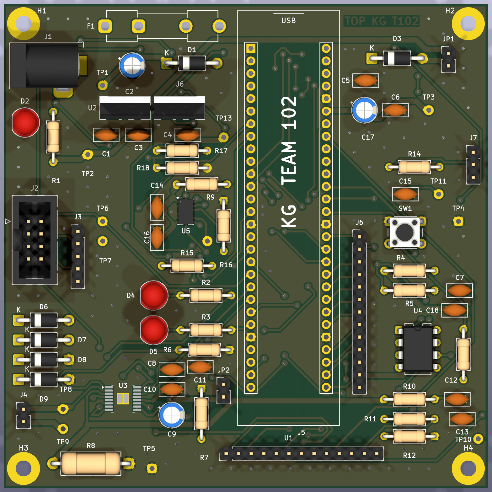
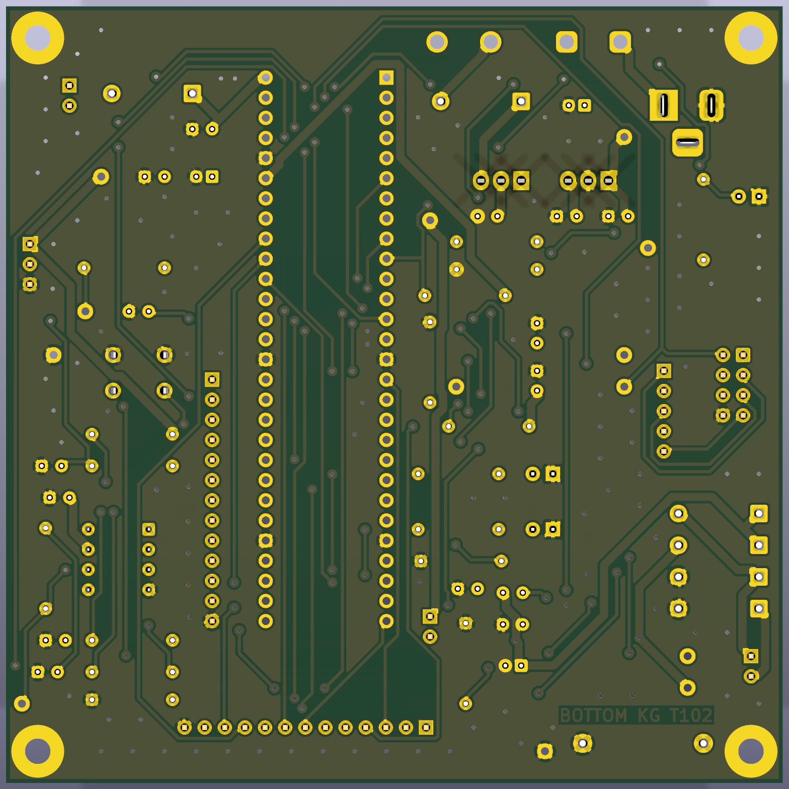
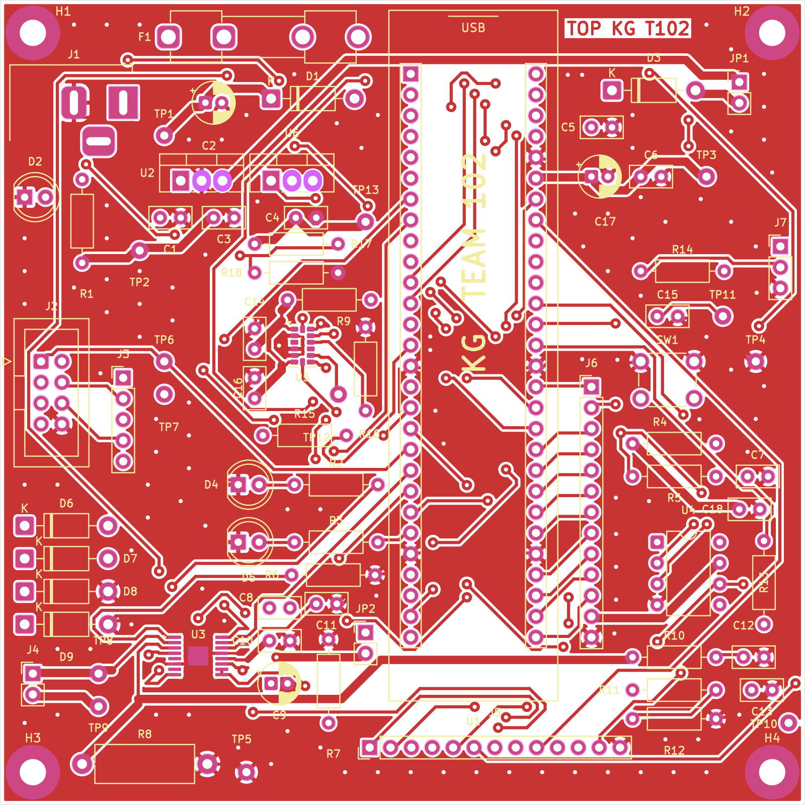
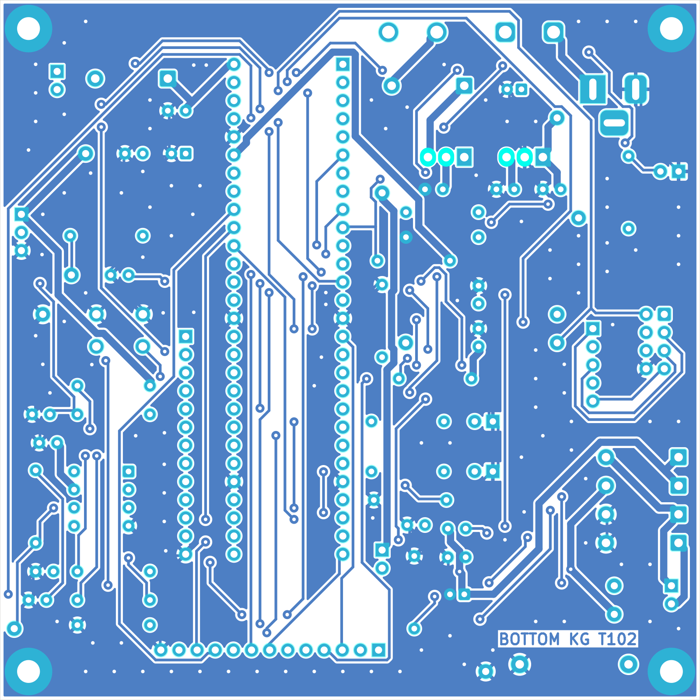

# PCB Design

**RAS 304 – Individual Datasheet (Kaushik) – Driver Nano 3: Linear Actuator B + IMU**
Project: Team 102 Modular Spider Leg (my board is the spoke on hub connector 3)

**Page link:** [https://kaushikgunasekaren.github.io/kgunase7_RAS304_F26/06-PCB-Design/PCB-Design/](https://kaushikgunasekaren.github.io/kgunase7_RAS304_F26/06-PCB-Design/PCB-Design/)

## Overview

This is the PCB layout of my [schematic](../04-Schematic/schematic.md), drawn in KiCad 10 and checked against the course rules (Peralta PCB mill specs and the RAS KiCad design-rule setup). It will be made by JLCPCB through the class order.

* **Board:** 98.0 × 98.0 mm, 2 copper layers (0.5 oz), solder mask and silkscreen, four plated M3 mounting holes (tied to GND) in the corners.
* **Identification:** "KG TEAM 102" in bold 2.5 mm text on the top silkscreen (under the Curiosity Nano), and copper labels "TOP KG T102" (F.Cu) and "BOTTOM KG T102" (B.Cu).
* **Ground:** a GND pour on both layers, tied together with stitching vias.

**Figure 1:** Top of the board (KiCad 3D view).

**Figure 2:** Bottom of the board (KiCad 3D view).

**Figure 3:** Front layout (F.Cu, F.Mask, F.Silkscreen, board outline).

**Figure 4:** Back layout (B.Cu, B.Mask, B.Silkscreen, board outline), shown mirrored as seen from the bottom.

## Resources

* PDF of the front and back layout: [*here*](PCB-Layout-Front-Back-KG.pdf).
* ZIP of the complete KiCad project (schematic, PCB, design rules, custom symbol library `RAS304_KG.kicad_sym` and footprint library `RAS304_KG.pretty`): [*here*](Subsystem-PCB-KG-ECAD.zip).
* ZIP of the Gerber and drill files sent to JLCPCB: [*here*](Gunasekaren_Kaushik_Team102.zip).
* KiCad DRC result: [*here*](Gunasekaren_Kaushik_DRC.png).

## Layout

The Curiosity Nano sits in the middle of the board on two 1×28 female headers, with its USB connector at the top edge. Each group of parts sits on the side of the Nano where its pins are:

| Area | Parts | Why there |
|---|---|---|
| Top left | Barrel jack J1 (opening at the board edge), fuse F1, D1, L7805CV (U2), LM317TG (U6), their capacitors, power LED | The jack is reachable from the edge, and the input, regulators and their input/output capacitors stay close together |
| Left middle | ADXL343 (U5) with C14/C16, ribbon header J2 and J3, UART test pads, debug LEDs | The SPI, UART and LED pins are on the Nano's left row |
| Bottom left | DRV8833 (U3) with C8–C11, flyback diodes D6–D9, motor header J4, sense resistor R8 | Short, wide motor and VM paths; the motor header is at the board edge |
| Top right | JP1, D3, C5 (VBUS feed), C17/C6 on 3.3 V | Next to the Nano's VBUS and VTG pins |
| Right | Pot header J7 with R14/C15, button SW1 with R4/R5/C7, MCP601 current-sense amplifier (U4) with R10–R13 | Next to the ADC (RA0, RA1) and button (RD5) pins on the Nano's right row |
| Along the Nano | Spare-GPIO headers J6 (right) and J5 (bottom, across both rows) | Short runs from each spare pin |

## Design rules used

| Rule | Value | Source |
|---|---|---|
| Minimum clearance | 10 mil (0.254 mm) | RAS KiCad DRC setup |
| Minimum track width | 15 mil (0.381 mm), used for signals | Peralta signal minimum |
| Power and ground tracks | 40 mil (1.016 mm) | Peralta / PCB checklist |
| Minimum annular ring | 15 mil (0.381 mm) | RAS KiCad DRC setup |
| Minimum via / hole | 19.7 mil (0.5 mm) | Peralta |
| Vias used | 1.27 mm pad, 0.5 mm drill (16 mil ring) | Meets the annular-ring rule |
| Copper to hole | 10 mil | RAS KiCad DRC setup |
| Hole to hole | 31.5 mil (0.8 mm) | RAS KiCad DRC setup |
| Solder mask clearance | 5 mil; 0.05 mm on C2/C9/C17 and 0 on the U3/U5 pads (see JLCDFM check) | RAS KiCad DRC setup |
| Drill sizes | 0.5, 0.8, 0.9, 1.0, 1.2, 1.8 mm (+ 3.2 mm plated mounting holes) | Peralta drill list |

**Fine-pitch exception.** The DRV8833 (HTSSOP-16, 0.65 mm pitch) and the ADXL343 (LGA-14, 0.8 mm pitch) have 0.20–0.25 mm gaps between their own pads, below the 10 mil rule. Neither part comes in a through-hole package (see [Component Selection](../02-Component-Selection/Component-Selection.md)). A custom rule (`fine_pitch_pads_KG` in `Subsystem_PCB_KG.kicad_dru`) allows 0.15 mm between those two parts' pads and the tracks next to them only, which JLCPCB can make (0.1 mm minimum). The GND pour keeps its normal 0.3 mm clearance there, and everywhere else the 10 mil rule applies.

**Trace widths.** Power nets (+9 V, +6 V, +5 V, +3.3 V, VBUS, VM, motor outputs, current sense) are in a "Power" net class at 40 mil. At 0.5 oz copper a 15 mil trace carries about 500 mA (Peralta note). The motor current is limited to about 0.61 A by the DRV8833 current chopping, so the motor paths are 40 mil except for short 15 mil stubs into the DRV8833's 0.4 mm-wide pins, and the 3.3 V spurs to the low-current IMU pins.

## Design checks

* **DRC:** KiCad DRC passes with **0 errors, 0 warnings, 0 unconnected items and 0 schematic-parity issues** ([result](Gunasekaren_Kaushik_DRC.png)).
* **Board size:** 98.0 × 98.0 mm (inside the 100 × 100 mm limit), measured on the board outline (Edge.Cuts).
* **Footprints:** every component has a footprint. Custom footprints are in `RAS304_KG.pretty` and carry my initials: `PIC18F57Q43_Curiosity_Nano_Socket_KG`, `BarrelJack_CUI_PJ-002A_KG`, `_KG` copies of the header, IDC, TO-220, DO-41, push-button and fuse-clip footprints with pads sized for the 15 mil annular ring, and `_KG` copies of the axial resistor, 5 mm LED, radial electrolytic and test-pad footprints with the silkscreen pulled back from the pads (JLCDFM check).
* **Curiosity Nano footprint:** two rows of 28 pins, 0.1 in pitch, rows 0.6 in (15.24 mm) apart, numbered 1–28 down the left row and 29–56 up the right row (matching the `PIC18F57Q43_Curiosity_Nano_KG` symbol). The board outline (20.32 × 83.82 mm) and USB end are drawn on the silkscreen. The row spacing and outline match the 56-pin Curiosity Nano board-outline drawing in Microchip's [AVR128DB48 Curiosity Nano schematics](https://ww1.microchip.com/downloads/aemDocuments/documents/MCU08/ProductDocuments/BoardDesignFiles/AVR128DB48-Curiosity-Nano-Schematics.pdf), which uses the same edge connector.
* **Decoupling:** C1/C2 at the regulator inputs, C3/C4 at the outputs, C10/C9 at the DRV8833 VM pin, C14/C16 beside the ADXL343, C18 at the MCP601.
* **Test points:** 13 test pads (TP1–TP13) on the power rails, UART, motor outputs and analog signals, plus GND pads.
* **No vias under ICs or other parts**, except in the open area under the plugged-in Curiosity Nano, which sits about 8.5 mm above the board on its sockets.
* **Mechanical:** M3 holes in all four corners; the barrel jack and motor header are at the board edges.

## JLCDFM check

The first upload of the Gerber files to [JLCDFM](https://dfm.jlcdfm.com/) reported these problems, which were fixed before the final Gerber ZIP above was made:

| JLCDFM result | Cause | Fix |
|---|---|---|
| Solder-mask bridge 0.1 mm (Danger ×10) | 0.05 mm mask expansion on the ADXL343's 0.2 mm pad gaps left 0.1 mm mask webs | Mask expansion set to 0 on U5 and U3, so the webs equal the pad gaps (0.2 mm and 0.25 mm); 0.05 mm on the closely spaced pads of C2/C9/C17 |
| Copper spacing 0.1 mm (Danger ×1, Warning ×20) | The fine-pitch 0.15 mm rule also applied to the GND pour, which flowed into U3/U5 as thin slivers | Rule limited to pads and tracks; the pour keeps 0.3 mm |
| Silkscreen to pad / to hole 0 mm (Danger) | Footprint outlines and reference text touching pad mask openings, vias and holes | Silkscreen pulled back at least 0.15 mm from every mask opening and drill hole; labels moved to clear spots |
| Silkscreen line width 0.12 mm (Warning) | KiCad library default | All silkscreen lines and text strokes 0.15 mm |
| PTH without pad (Warning ×8) | Unplated M3 holes in the plated drill file | Plated M3 mounting holes with a pad, tied to GND |

After the fixes, KiCad DRC is still clean (0 errors, 0 warnings, 0 unconnected, 0 parity issues).

## Open items before ordering

1. Print the board 1:1 and place the real parts on the printout, especially the Curiosity Nano (row spacing), the PJ-002A jack, the IDC header and the fuse clips.
2. Re-run the JLCDFM check on the final Gerber ZIP.
3. Check that the LM317TG heatsink fits behind U6 (see the [Power Budget](../05-Power-Budget/Power-Budget.md)).
